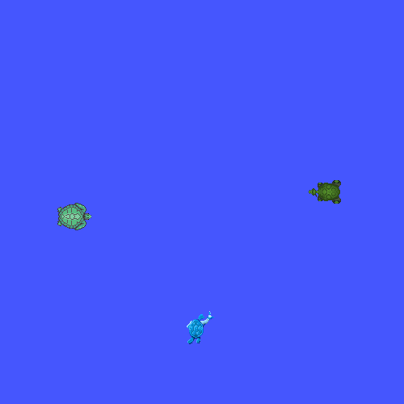
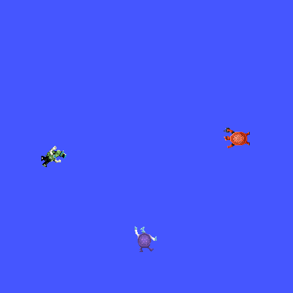

# FleetPOSIX

Projeto da disciplina de Sistemas Operacionais: uma central POSIX coordena
tres robos moveis autonomos (AMRs) independentes que disputam uma regiao
critica compartilhada (o corredor central de um almoxarifado). Os robos sao
visualizados como tartarugas no Turtlesim (ROS 2 Jazzy).

## Objetivo

Demonstrar, em uma aplicacao executavel e reprodutivel, programacao
concorrente, sincronizacao e comunicacao entre processos com as APIs POSIX
explicitas. O ROS 2 fica restrito a pose, movimento e visualizacao; todo o
plano de controle (criacao de processos, threads, exclusao mutua e IPC) e
POSIX. Um modo `--unsafe` desliga a exclusao mutua do corredor e expoe a
condicao de corrida como colisoes logicas, permitindo comparar problema e
solucao.

## Entrega e reproducao

| Item | Local ou comando |
| --- | --- |
| Codigo-fonte, build e testes | `src/fleet_posix/` e `Makefile` |
| Integrantes e responsabilidades | [Equipe](#equipe) |
| Validacao automatizada | `make verify`: build, estilo, teste C++ e 12 cenarios Python |
| Comparacao sem janela | `make simulate`: seguro com 0 colisoes; inseguro com pelo menos 1 |
| Demonstracao visual | `make demo` e `make demo-unsafe` no WSLg |
| Apresentacao e roteiro | [Apresentacao oficial no Canva e materiais de apoio](docs/README.md) |
| Evidencias registradas | [Validacao de entrega em 25/11/2026](docs/evidence/2026-11-25/README.md) e [capturas de 23/11/2026](docs/evidence/2026-11-23/README.md) |

Para reproduzir em outra maquina, obtenha o repositorio e entre na sua raiz:

```bash
git clone https://github.com/luix-felipe/OS_ROS2_Project.git
cd OS_ROS2_Project
make env
make verify
make simulate
```

Execute esses comandos no Ubuntu/WSL com os pre-requisitos abaixo instalados.
Se a copia estiver no Windows, abra o Ubuntu na pasta do repositorio ou use
`wsl -d Ubuntu -- make help` pelo PowerShell nessa pasta. O caminho da raiz
pode conter espacos; nenhum diretorio em `/home` precisa ter nome fixo.

## Demonstracao animada

| Modo seguro | Modo inseguro |
| --- | --- |
|  |  |
| Travessias serializadas; 3 missoes e 0 colisoes. | Convergencia simultanea; 3 missoes e 2 colisoes logicas. |

Materiais para apresentacao:

- [apresentacao oficial no Canva](https://www.canva.com/design/DAHb4r2qxhU/bvRyO4jD2x-MbVPsWD2EyQ/edit);
- [atalho local da apresentacao](docs/FleetPOSIX_apresentacao.url);
- [roteiro de apoio](docs/FleetPOSIX_roteiro.md);
- [video seguro em MP4](docs/media/fleet-safe.mp4);
- [video inseguro em MP4](docs/media/fleet-unsafe.mp4).

A versao do Canva substitui as apresentacoes anteriores de `docs/`. Os GIFs
e MP4 permanecem como material de apoio. Para entregar ou apresentar sem
internet, exporte a versao atual do Canva e confira o arquivo antes de usar.
Orientacoes e referencia oficial: [`docs/README.md`](docs/README.md).

## Equipe

- **Luiz Felipe Souza da Silva** (mantenedor do pacote e do repositorio)
- **Elian Lima Pereira**
- **Diogo de Mello Silva**

### Atribuicoes gerais do projeto

| Atribuicao | Responsaveis |
| --- | --- |
| Concepcao do projeto e definicao do cenario (AMRs e corredor critico) | Luiz Felipe, Elian |
| Arquitetura de processos, threads e IPC | Luiz Felipe, Elian |
| Supervisor (`fork`/`exec`, `waitpid`, filas POSIX, memoria compartilhada, logs) | Luiz Felipe, Elian |
| Agentes AMR (pthreads, mutex, variavel de condicao, semaforos, produtor-consumidor) | Luiz Felipe, Elian |
| Integracao com ROS 2 / Turtlesim | Luiz Felipe, Elian |
| Testes automatizados e automacao Make | Luiz Felipe, Elian |
| Repositorio GitHub e manutencao do pacote | Luiz Felipe |
| Apresentacao (slides) | Luiz Felipe, Elian, Diogo |
| Revisao tecnica do codigo e da sincronizacao | Diogo |
| Correcoes (secao critica, relogio monotonico, stdin dos filhos, `demo.sh`) e canal FIFO | Diogo |
| Revisao da documentacao (README) | Diogo |

Uso academico. O pacote declara `Proprietary` no `package.xml`; a equipe nao
definiu uma licenca de codigo aberto.

## Arquitetura

```text
                         operador (terminal)     outro terminal
                               | stdin                | echo > FIFO
                               v                      v
                   +------------------------------------------+
                   | fleet_supervisor (processo pai)          |
                   |  poll(stdin, FIFO) -> comandos           |
                   |  detector de colisoes | thread de logs   |
                   +------------------------------------------+
           fork+exec |     mq_send (1 fila POSIX por AMR)  ^ pipe (LogEvent)
        +------------+-------------+--------------+        |
        v            v             v              v        |
  turtlesim_node  amr_agent 1   amr_agent 2   amr_agent 3 -+
                  3 pthreads cada: spin ROS | comandos (produtor) | controle (consumidor)

  Memoria compartilhada /fleet_posix_state_<pid> (shm_open + mmap):
    pthread_mutex robusto e PROCESS_SHARED + estado da frota
    sem_t corridor (pshared=1, valor 1) = exclusao mutua no corredor
```

## Mecanismos de concorrencia, sincronizacao e IPC

| Conceito da disciplina | Onde e como e usado |
| --- | --- |
| Processos | `supervisor.cpp`: `fork` + `execl` do Turtlesim e de 3 agentes; `waitpid` (com `WNOHANG` e prazo), `_exit` no filho |
| Threads POSIX | `amr_agent.cpp`: `pthread_create`/`pthread_join` (spin ROS, comandos, controle); thread de logs no supervisor |
| Mutex | mutex `PTHREAD_PROCESS_SHARED` + `PTHREAD_MUTEX_ROBUST` em `FleetState`; mutexes locais de pose, movimento e buffer |
| Variavel de condicao | `pthread_cond_timedwait` (relogio monotonico): controle aguarda nova pose sem espera ocupada |
| Semaforos POSIX | `sem_init(pshared=1)` para o corredor (`sem_clockwait`/`sem_post`); par `free_slots`/`used_slots` no buffer |
| Produtor-consumidor | buffer circular limitado (4 missoes) entre a thread de comandos e a thread de controle |
| Secao critica / corrida | travessia do corredor protegida no modo seguro; `--unsafe` demonstra a condicao de corrida |
| Pipe | `pipe`: agentes enviam `LogEvent` (< `PIPE_BUF`, escrita atomica) ao supervisor |
| Named pipe (FIFO) | `mkfifo /tmp/fleet_posix_ctl_<pid>`: comandos de outro terminal, multiplexados com stdin via `poll` |
| Filas de mensagens POSIX | `mq_open`/`mq_send`/`mq_receive`: uma fila por AMR, comandos de controle com prioridade maior |
| Memoria compartilhada | `shm_open` + `ftruncate` + `mmap`: pose, missao e estado de toda a frota |
| Sinais | `sigaction` para `SIGINT`/`SIGTERM`; `kill(SIGTERM/SIGKILL)` no shutdown escalonado |

Detalhes de funcionamento e limites do modelo:
[`src/fleet_posix/README.md`](src/fleet_posix/README.md).

## Pre-requisitos

Ubuntu 24.04 (nativo ou WSL 2) com ROS 2 Jazzy. Em uma maquina sem ROS:

```bash
# Repositorio ROS 2: https://docs.ros.org/en/jazzy/Installation/Ubuntu-Install-Debs.html
sudo apt install ros-jazzy-ros-base ros-jazzy-turtlesim ros-jazzy-ament-cmake \
  ros-jazzy-ament-uncrustify python3-colcon-common-extensions build-essential
```

`make env` confere o compilador, CMake, Python 3, colcon, ROS 2, ferramentas de
estilo, pacotes ROS e acesso a `/dev/shm` e `/dev/mqueue`. A referencia validada
usa GCC 13, C++17 e GNU Make. `make verify` nao instala dependencias.

O codigo usa IPC POSIX do Linux: nao compila no Windows nativo. Para a
demonstracao visual no WSL e necessario WSLg (`DISPLAY` ou `WAYLAND_DISPLAY`).

## Como executar

Na raiz do repositorio (nao e preciso `source` antes do `make`):

```bash
make demo            # demonstracao visual segura no WSLg
make demo-unsafe     # demonstracao visual insegura no WSLg
make run             # operacao online segura com visualizacao
make run-unsafe      # operacao online insegura com visualizacao
make simulate        # comparacao segura/insegura sem janela, com resumo
make test            # testes sem interface grafica
make verify          # ambiente -> build -> estilo -> testes em sequencia
make ipc             # lista processos e objetos IPC: memoria, filas e FIFO
```

Comandos da operacao online, um por linha no terminal ou no FIFO:

```text
enviar <amr> <x> <y>
pausar <amr>
retomar <amr>
status
sair
```

Os IDs aceitos sao 1, 2 e 3. As coordenadas ficam entre 0.5 e 10.5; destinos
dentro do circulo central de raio 2.35 em torno de (5.5, 5.5) sao recusados.
O intervalo de coordenadas e a exclusao central valem nos dois modos.

### Exemplo seguro: missao, pausa e status

Execute `make run` e aguarde os tres agentes ficarem online. Envie:

```text
enviar 1 9.0 5.15
enviar 2 5.5 9.0
enviar 3 2.0 5.85
```

Durante o movimento, pause o AMR 1 e consulte o estado:

```text
pausar 1
status
```

Continue com `retomar 1` e consulte `status` novamente. Se o AMR pausado
possuir o corredor, os demais esperam ate ele retomar e liberar a regiao.
Use `sair` ou `Ctrl+C` para encerrar a frota e remover seus IPCs.

### Exemplo inseguro: cruzamento simultaneo

Inicie uma nova execucao com `make run-unsafe`, aguarde os agentes ficarem
online e envie as mesmas tres missoes acima. As rotas se cruzam no centro;
sem o semaforo, o detector pode registrar colisoes logicas. `status` mostra
o contador. Para a comparacao automatica com resultado verificado, use
`make simulate` ou `make demo-unsafe`.

### Comandos de outro terminal (FIFO)

O supervisor imprime `/tmp/fleet_posix_ctl_<pid>` na inicializacao. Substitua
`<pid>` pelo numero mostrado e confira o caminho antes de escrever:

```bash
FIFO="/tmp/fleet_posix_ctl_<pid>"
test -p "$FIFO" && printf '%s\n' 'status' > "$FIFO"
test -p "$FIFO" && printf '%s\n' 'enviar 1 9.0 5.15' > "$FIFO"
```

Esse canal pertence a uma execucao especifica e e removido no shutdown. O
FIFO recebe texto; as filas POSIX continuam levando os comandos aos agentes.

### Comandos manuais equivalentes

Equivalente manual, sem Make:

```bash
source /opt/ros/jazzy/setup.bash
colcon build --symlink-install
source install/setup.bash
ros2 run fleet_posix fleet_supervisor --demo            # ou --demo --unsafe, ou sem opcoes
```

## Testes

`make test` executa duas entradas CTest, sem interface grafica: um teste C++ de
recuperacao do mutex robusto apos morte do processo dono e 12 cenarios de
integracao em Python (demos segura/insegura, FIFO, sinais, buffer cheio,
corredor ocupado com dono pausado, falhas parciais de IPC, morte de agente).
Cada cenario confere que nao restam processos nem objetos IPC
(`/dev/shm`, `/dev/mqueue`, FIFO em `/tmp`).

Sao **13 cenarios no total**, agrupados em **duas entradas CTest**. O resumo
do `colcon test-result` pode contabilizar os relatorios CTest e JUnit; essa
contagem de relatorios nao corresponde ao numero de cenarios Python.

Resultados esperados nas demonstracoes:

| Modo | Missoes concluidas | Colisoes logicas |
| --- | --- | --- |
| Seguro | 3 | 0 |
| Inseguro | 3 | Pelo menos 1; foram observadas 2 nas evidencias registradas |

O executavel retorna erro se uma demo nao concluir as missoes no prazo ou
se a contagem de colisoes nao corresponder ao modo. O modo online depende
dos comandos e do tempo de envio do operador, sem prometer contagem fixa.

Para acompanhar as tres missoes automaticamente em uma janela do Turtlesim,
use `make demo` (seguro) ou `make demo-unsafe` (inseguro). Cada alvo compila,
abre o WSLg e encerra ao concluir a demonstracao, retornando erro se o resultado
for inesperado. `make test-safe` e `make test-unsafe` continuam disponiveis como
nomes alternativos. Esses testes visuais nao executam a suite CTest completa.

## Automacao Make

No PowerShell, os mesmos alvos funcionam com `wsl -d Ubuntu -- make verify`.
`make help` lista os principais alvos; `make status` mostra o andamento.

### Referencia dos alvos Make

| Alvo | Comportamento e resultado |
| --- | --- |
| `make help` | Mostra os comandos, a sequencia sugerida e as variaveis configuraveis. E o alvo padrao. |
| `make status` | Le o andamento desta documentacao e aponta overlay, resultados CTest e logs locais existentes. |
| `make env` | Confere ferramentas, seis pacotes ROS e acesso a `/dev/shm` e `/dev/mqueue`. Opcionais ausentes geram avisos. |
| `make deps` | Executa `rosdep check`; falha se rosdep, sua base ou dependencias estiverem ausentes. Nao instala nada. |
| `make build` | Compila com `colcon build --symlink-install`, testes habilitados e `-Werror` preservado. |
| `make lint` | Verifica estilo C++ em fontes, headers e testes, sem modificar arquivos. |
| `make format` | Aplica `ament_uncrustify --reformat` e confere o resultado. Modifica fontes; revise o diff. |
| `make test` | Compila, roda CTest offscreen e imprime `colcon test-result --verbose`. Falhas sao propagadas. |
| `make report` | Le os resultados ja registrados. Exige os dois resultados esperados; nao executa novos testes. |
| `make verify` | Encadeia ambiente, build, estilo e testes. Compila uma vez e interrompe na primeira etapa que falhar. |
| `make simulate` | Compila e executa primeiro seguro e depois inseguro, sem janela, com timeout e logs separados. |
| `make demo` / `make demo-unsafe` | Compilam e abrem a demonstracao correspondente no WSLg. |
| `make test-safe` / `make test-unsafe` | Nomes alternativos para `make demo` / `make demo-unsafe`. |
| `make run` / `make run-unsafe` | Compilam e iniciam a operacao online correspondente com visualizacao. |
| `make ipc` | Lista processos e objetos IPC: memoria compartilhada, filas e FIFO da maquina, incluindo possiveis outras execucoes. Nao remove recursos. |
| `make slides` | Mostra o link da apresentacao oficial no Canva e orienta a exportacao para entrega. |
| `make clean` | Remove apenas `build/`, `install/` e `log/` desta copia, incluindo resultados e logs locais. Recusa links simbolicos nesses destinos. |

O `make verify` ja executa as duas demonstracoes por meio da suite de integracao.
`make simulate` serve para acompanhar a comparacao isoladamente, com os logs
da frota visiveis no terminal. Nenhum dos dois precisa de WSLg. As tarefas
visuais ficam fora da verificacao automatica e exigem `DISPLAY` ou
`WAYLAND_DISPLAY`. Na operacao online, use `sair` ou `Ctrl+C` para encerrar.

As tarefas param quando uma ferramenta falha: um build com erro impede os
testes, uma divergencia de estilo reprova `lint`, e um timeout ou resultado
inesperado reprova `simulate`. `make report` consulta resultados anteriores;
apenas `make test`/`make verify` atualizam a evidencia de testes. Nenhum alvo
instala pacotes, executa `sudo`, altera licenca ou publica no Git.

#### Configuracao

| Variavel | Padrao | Uso |
| --- | --- | --- |
| `ROS_DISTRO` | `jazzy` | Distribuicao usada na descoberta do setup e no rosdep. Ambiente de referencia: Jazzy. |
| `ROS_SETUP` | `/opt/ros/$(ROS_DISTRO)/setup.bash` | Arquivo do ambiente ROS; pode apontar para outra instalacao. |
| `ROS_DOMAIN_ID` | `0` | Dominio das simulacoes. Os testes mantem seu dominio separado. |
| `JOBS` | `2` | Paralelismo de compilacao CMake e numero de workers do colcon. Deve ser inteiro positivo. |
| `DEMO_TIMEOUT` | `45s` | Limite externo por demo offscreen em `make simulate`; aceita a sintaxe do GNU timeout. |
| `PYTHON` | `python3` | Python conferido pelo diagnostico do ambiente. O build descobre seu Python via CMake. |

Exemplo para executar a comparacao em um dominio ROS separado:

```bash
make simulate ROS_DOMAIN_ID=171 JOBS=2 DEMO_TIMEOUT=45s
```

O Make serializa os alvos mesmo com `make -j`, para que build, teste e simulacao
nao disputem a mesma copia. O script auxiliar descobre a raiz por sua propria
localizacao e preserva caminhos com espacos, como o caminho deste repositorio
no Windows/WSL. Os arquivos de texto usam LF.

#### Logs e diagnostico

- `log/automation/test.log`: saida da ultima suite executada por Make.
- `log/automation/demo-safe.log` e `demo-unsafe.log`: ultima comparacao offscreen.
- `build/fleet_posix/test_logs/`: logs individuais dos cenarios de integracao.
- `make ipc`: inspecao de processos e memoria/filas POSIX apos a execucao.

`rosdep` e usado somente por `make deps`. Essa verificacao
e separada: exige rosdep instalado, sua base inicializada e as
dependencias resolvidas. Na validacao de 25/11/2026, rosdep nao estava instalado;
essa verificacao nao foi executada. O build encontrou as dependencias CMake.

### Preparacao para a apresentacao

1. Execute `make verify` e `make simulate` antes de apresentar.
2. Confira os logs e use `make ipc` depois de encerrar suas execucoes.
3. Abra a apresentacao oficial no Canva e confira o acesso. Se precisar de
   uma copia offline, exporte a versao atual e confira sua reproducao; mantenha
   os videos das simulacoes como apoio.
4. Para demonstrar ao vivo, execute `make demo` e depois `make demo-unsafe`.
5. Para demonstrar comandos online, use o exemplo de pausa e status acima.

O Turtlesim e uma abstracao visual 2D. O MVP nao faz planejamento de rotas,
desvio de obstaculos ou validacao de safety industrial. Os resultados de
ausencia de colisao se referem as rotas de referencia; evite destinos que
coincidam com a posicao de espera de outro AMR.

## Andamento do projeto

<!-- andamento:inicio -->
Referencia revalidada em 2026-11-25. O quadro descreve o projeto; a existencia de
artefatos locais nao comprova que o codigo atual passou nas verificacoes.

| Etapa | Situacao | Evidencia ou proximo passo |
| --- | --- | --- |
| MVP e APIs POSIX | Implementado | Tres AMRs, processos, pthreads, sincronizacao e IPC explicitos. |
| Build e estilo C++ | Validados | GCC 13, C++17, -Werror e ament_uncrustify. |
| Testes sem janela | Validados | 12 cenarios Python + teste C++ de mutex robusto; use make test. |
| Comparacao segura/insegura | Validada | 3 missoes por modo; 0 colisoes no seguro, 2 no inseguro na referencia. |
| WSLg e operacao online | Validados | Demo visual e shutdown com pausa/corredor ocupado exercitados. |
| Automacao Make | Validada | make -j4 verify e make simulate aprovados; propagacao de falhas e limpeza conferidas. |
| Apresentacao | Referencia oficial definida | Versao do Canva indicada em docs/README.md; exportacao offline pela equipe quando necessaria. |
| Dependencias via rosdep | Nao verificado | rosdep ausente nesta maquina; verificacao opcional separada com make deps. |
| Dados da equipe e licenca | Definidos | Equipe e divisao de trabalho na secao Equipe; pacote declarado Proprietary. |
<!-- andamento:fim -->

Para acompanhar outra copia ou apos alterar os fontes, execute `make status`
e depois `make verify`. O quadro de referencia deve ser atualizado apenas
depois de repetir as validacoes relevantes.

A documentacao funcional, os comandos manuais equivalentes e o mapeamento
para a disciplina estao em [`src/fleet_posix/README.md`](src/fleet_posix/README.md).

## Material de entrega

- Apresentacao oficial: [FleetPOSIX no Canva](https://www.canva.com/design/DAHb4r2qxhU/bvRyO4jD2x-MbVPsWD2EyQ/edit).
- Atalho da apresentacao: [`docs/FleetPOSIX_apresentacao.url`](docs/FleetPOSIX_apresentacao.url).
- Orientacoes para usar e exportar a apresentacao: [`docs/README.md`](docs/README.md).
- Roteiro: [`docs/FleetPOSIX_roteiro.md`](docs/FleetPOSIX_roteiro.md).
- Evidencias: [validacao automatizada de 25/11/2026](docs/evidence/2026-11-25/README.md) e [capturas e logs de 23/11/2026](docs/evidence/2026-11-23/README.md).
- Mantenedor no `package.xml`: Luiz Felipe Souza da Silva (luix.felipe008@gmail.com).
- Integrantes e divisao de trabalho: secao [Equipe](#equipe).
- Sem licenca de codigo aberto (`Proprietary` no `package.xml`).

Use `make slides` para consultar a referencia oficial. Edicoes e exportacoes
devem partir do Canva, para evitar divergencia entre versoes da apresentacao.
